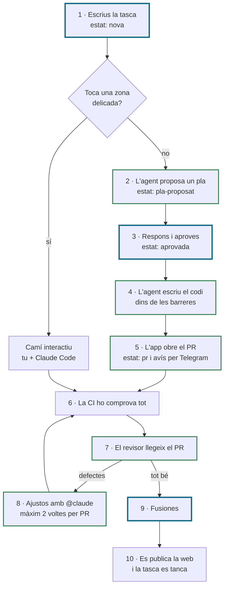

# nucli

El nucli fa que els agents de codi (Claude Code, Kimi, Codex) treballin igual i de forma fiable a tots els projectes. Són tres coses: uns **docs** amb el mateix nom a cada repo, una **porta amb rebut** (no es puja res sense haver passat els checks que toquen, i ho demostra un rebut segellat contra el commit) i un **cicle** que fan tots els agents. El que canvia de projecte a projecte és a `nucli.json`, i el nucli només hi posa el mecanisme.

## El flux de treball

Cada canvi neix d'una tasca, que és un issue de GitHub, i arriba a la web per un PR que els agents de Claude escriuen i proven dins d'unes barreres que es comproven soles.

Tu només hi intervens en tres moments:

1. **Escrius la tasca:** el què i un criteri de fet que es pugui comprovar.
2. **Aproves el pla:** contestes les preguntes de l'agent i poses `estat: aprovada`.
3. **Fusiones:** després de la CI i del revisor. Només tu pots, perquè `main` està protegida.



Les caselles amb la vora blava són els tres moments en què intervens tu. Les verdes són els agents.

### Un o diversos agents alhora

Cada agent és una execució de GitHub Actions, i GitHub en pot fer anar diverses al mateix temps. Depèn d'on treballin:

- **En tasques diferents, sí.** L'agent del pla pot escriure el pla d'una tasca mentre l'agent que implementa en fa una altra. Totes gasten de la mateixa subscripció, i per això els límits del dia compten el total.
- **En una mateixa tasca o un mateix PR, d'un en un.** Un `@claude` cada vegada: espera la resposta i els checks en verd abans del següent.
- **Dins d'un sol agent, no.** Claude Code pot crear subagents que treballin en paral·lel, però les barreres només li deixen llegir, buscar i editar.

**Com saps què treballa ara mateix:** a **Actions** (també a l'app de GitHub del mòbil), cada agent en marxa surt com una execució 🟡 en curs; a la tasca, l'etiqueta `estat: en-curs`; al teu comentari, els ulls 👀; i a Telegram, l'avís quan s'obre un PR i el resum del matí.

**El risc del paral·lel:** si dues tasques toquen el mateix fitxer, el segon PR pot tenir conflictes quan fusionis el primer. L'agent no pot reescriure la branca, perquè el `push` forçat li està prohibit, i per això el conflicte el resols tu pel camí interactiu. Amb tasques petites que toquen fitxers diferents, gairebé no passa.

### El motor dels agents

Cada agent del flux és **Claude Code executat sense pantalla** (`claude -p`) dins de GitHub Actions. Aquest motor (en anglès, *harness*) és el bucle que pensa, crida les eines i decideix quan ha acabat. És el mateix que fa servir l'[Agent SDK](https://code.claude.com/docs/en/agent-sdk/overview) d'Anthropic. Les barreres del flux són la configuració d'aquest motor.

| Manera | Què és | Com es paga |
|---|---|---|
| **Claude Code CLI** (la del flux) | El motor, cridat amb `claude -p` des d'un workflow | La subscripció, amb el token de `claude setup-token` |
| **Agent SDK** | El mateix motor, com una biblioteca de Python o TypeScript dins d'un programa teu | Una clau de l'API, per ús |
| **Managed Agents** | Anthropic allotja el motor al seu núvol | Una clau de l'API, per ús |

**Si muntes el flux per a un client**, ha d'anar amb la clau o la subscripció del client, mai amb la teva. Anthropic no permet oferir a tercers l'inici de sessió de claude.ai ni els límits d'una subscripció.

## Estat (24 d'octubre de 2026, 11:00)

Al repo pilot, la web de Novak Code, els deu passos del flux funcionen, i la fase B (els agents de GitHub) està acabada: 9 de 9 PR fusionats. El 24-10 es va provar en calent l'últim que faltava, el revisor, amb tres proves: un PR de l'agent, una frase prohibida en un PR teu, que la CI i el revisor van parar, i el revisor apagat amb el límit del dia a 0.

| Què | Estat |
|---|---|
| Passos 1 a 10 al repo pilot | ✅ funcionen |
| Fase B, els agents de GitHub | ✅ acabada el 24-10 |
| Mods de sèrie de Claude Code acceptats i telemetria apagada | 🔧 fet i segellat, falta pujar-lo |
| Millores del revisor: no refiar-se del cos d'un PR antic, i treure un avís d'error fals | 🔧 pla aprovat |
| Tasca d'infra, botons als avisos de Telegram i bucle de correcció automàtic | ⏳ següent |
| Plantilla de projecte nou | ⏳ després |

El detall de cada pas és a [docs/FLUX.md](docs/FLUX.md#estat-dimplantació-24-doctubre-de-2026-1100), i la [pàgina visual](https://victorvqg.github.io/nucli/flux.html) ho ensenya tot junt.

## Instal·lació

Cal un Mac amb `git`, `python3` (n'hi ha prou amb el 3.9 de macOS, perquè només fa servir la biblioteca estàndard) i Claude Code. Les ordres que parlen amb GitHub també necessiten `gh`.

```bash
git clone https://github.com/victorvqg/nucli.git
cd nucli
./install.sh --dry-run   # diu què faria, sense escriure res
./install.sh
```

`install.sh` s'executa un cop a cada Mac i no toca cap repo ni cap permís:

- enllaça `bin/nucli` a `~/.local/bin/nucli` (aquesta carpeta ha de ser al `PATH`);
- enllaça les skills de `skills/` a `~/.claude/skills/`;
- afegeix els hooks del nucli a `~/.claude/settings.json`, amb una còpia de seguretat abans.

Si un destí ja existeix i no és del nucli, no el toca i t'ho diu. Si mous el clon, torna'l a executar.

Després, a cada repo: `nucli init --dry-run` per veure què farà, i `nucli init` per fer-ho. No fa commit: t'ho deixa per revisar.

## Començar una webapp nova

De zero fins als agents. Cada pas diu on es fa: al **Terminal**, a **Claude Code**, al **navegador** o a **Telegram**.

1. **Instal·la el nucli** · Terminal, un cop per Mac. És la instal·lació de l'apartat anterior. Si ja la tens, salta aquest pas.

2. **Crea el repo, privat, i clona'l** · Terminal.

   ```bash
   gh repo create la-meva-webapp --private --add-readme --clone
   cd la-meva-webapp
   ```

   També es pot fer al navegador, a github.com/new, marcant **Private** i **Add a README file**, i després clonar-lo al Terminal amb `git clone`. Cal el README perquè `main` tingui un primer commit i els PR hi tinguin base.

3. **Prepara el repo amb el nucli i obre el primer PR** · Terminal i navegador.

   ```bash
   nucli init --dry-run        # diu què farà, sense escriure res
   nucli init
   cat .nucli/proposta/*.md    # el que et proposa sense aplicar-ho
   git switch -c chore/nucli
   git add -A
   git commit -m "chore: prepara el repo amb el nucli"
   nucli ship seal
   nucli finish                # confirmes, puja la branca i obre el PR
   ```

   `init` crea els docs, `AGENTS.md`, `CLAUDE.md`, `nucli.json` i `.claude/settings.json`, i activa els hooks de git. El que hi ha a `.nucli/proposta/` no va a git: el que vulguis, aplica-ho tu a mà abans del commit. En un repo nou, sol ser `Bash(nucli secret:*)` al `deny` de `.claude/settings.json`. Després, al navegador, fusiona el PR.

4. **Revisa `nucli.json`** · Claude Code, i el PR amb `nucli finish` al Terminal.
   - `checks` i `per_defecte` surten buits: s'omplen amb les ordres de lint, proves i build quan existeixin.
   - `regles` diu quins fitxers demanen quins checks.
   - A `risc` hi van les parts del codi que fan una fusió difícil de desfer (migracions, cobrament, dades…), perquè el PR ho avisi.
   - `tasques` ha de ser `{"font": "github-issues", "branca": "issue/"}`, perquè les tasques siguin issues de GitHub.

5. **Protegeix `main` i crea les etiquetes** · navegador o Terminal.

   Al navegador: **Settings → Rules → Rulesets → New ruleset → New branch ruleset**. Posa-hi un nom i **Enforcement status: Active**. A **Target branches**, tria **Add target → Include default branch**. Després marca:
   - **Restrict deletions**;
   - **Require a pull request before merging**, amb 0 aprovacions, perquè puguis fusionar els teus PR;
   - **Require status checks to pass before merging**, amb el check obligatori de la CI;
   - **Block force pushes**.

   En un repo privat, la protecció de branques necessita GitHub Pro, Team o Enterprise. Amb el pla gratuït només funciona en repos públics ([documentació de GitHub](https://docs.github.com/en/repositories/configuring-branches-and-merges-in-your-repository/managing-protected-branches/about-protected-branches)).

   El check de la CI només s'hi pot posar quan la CI ja existeix, i la crea la tasca de l'stack (pas 6). Fins aleshores, deixa'l per més tard: un check obligatori que no arriba mai bloca tots els PR.

   <details>
   <summary>El mateix amb <code>gh</code></summary>

   Desa això com a `main.json`, amb el nom del check de la teva CI:

   ```json
   {
     "name": "main",
     "target": "branch",
     "enforcement": "active",
     "conditions": {"ref_name": {"include": ["~DEFAULT_BRANCH"], "exclude": []}},
     "rules": [
       {"type": "deletion"},
       {"type": "non_fast_forward"},
       {"type": "pull_request", "parameters": {
         "required_approving_review_count": 0,
         "dismiss_stale_reviews_on_push": false,
         "require_code_owner_review": false,
         "require_last_push_approval": false,
         "required_review_thread_resolution": false}},
       {"type": "required_status_checks", "parameters": {
         "strict_required_status_checks_policy": false,
         "required_status_checks": [{"context": "NOM-DEL-CHECK-DE-LA-CI"}]}}
     ]
   }
   ```

   I, des de la carpeta del repo:

   ```bash
   gh api repos/{owner}/{repo}/rulesets -X POST --input main.json
   ```

   Si encara no tens CI, treu la regla `required_status_checks` i torna-la a posar quan existeixi.
   </details>

   Les etiquetes, al Terminal (o al navegador, a **Issues → Labels → New label**):

   ```bash
   for e in nova pla-proposat aprovada en-curs bloquejada pr; do gh label create "estat: $e"; done
   for z in infra legal producte cobrament dades; do gh label create "zona: $z"; done
   for m in S M L; do gh label create "mida: $m"; done
   for l in tasca interactiu P1 P2 P3 revisa; do gh label create "$l"; done
   ```

   Les zones delicades són de cada projecte: no hi ha una llista única. Cada projecte tria les seves segons el que el fa delicat. Per exemple, una web que cobra pot fer servir `infra`, `legal`, `producte`, `cobrament` i `dades`, i una app amb usuaris menors, `auth`, `bd`, `infra`, `menors` i `producte`. A la línia de `zona:`, posa-hi les del teu projecte. La llista ha de coincidir a dos llocs: a la configuració de l'agent del pla (pas 8) i a les etiquetes de zona del repo. Si no coincideixen, una tasca delicada podria anar per l'agent en lloc del camí interactiu.

   L'etiqueta `revisa` serveix per demanar el revisor en un PR teu. El PR ha de venir d'una branca `issue/N-…` d'una tasca teva (la que fa `nucli tasca N`): si no, el revisor no l'agafa. Els PR de l'agent es revisen sols quan són llestos: si l'agent l'obre en esborrany, prem «Ready for review».

6. **Fes els fonaments pel camí interactiu** · navegador, Terminal i Claude Code.

   Les primeres tasques les fas tu amb Claude Code, una cosa per tasca i en aquest ordre: l'stack (amb la CI i els `checks` de `nucli.json`), el disseny base, l'accés d'usuaris, la base de dades i la publicació. Per a cada tasca:
   1. **Navegador:** obre-la com un issue.
   2. **Terminal:** `nucli tasca N` crea la branca `issue/N-…` i posa l'issue a `estat: en-curs`.
   3. **Claude Code:** «Segueix amb la tasca N». Claude fa el canvi i els commits, i segella el rebut.
   4. **Terminal:** `nucli finish` passa els checks, puja la branca i obre el PR amb `Closes #N`.
   5. **Navegador:** amb la CI en verd, fusiones.

   Quan la CI de l'stack hagi passat un cop, afegeix-ne el check a la regla de `main` (pas 5).

7. **Connecta els avisos a Telegram** · Telegram, Terminal i navegador.
   1. **Telegram:** escriu a @BotFather, envia-li `/newbot` i tria el nom del bot i un usuari acabat en `bot`. BotFather et dona el **token** del bot.
   2. **Telegram:** obre el xat amb el bot nou i envia-li qualsevol missatge, o afegeix-lo al grup on vulguis els avisos. Si no, el bot no hi pot escriure.
   3. **Terminal:** treu l'identificador del xat. El número que surt és l'identificador; en un grup, és negatiu.

      ```bash
      read -rs TOKEN    # enganxa el token i prem Retorn: no es veu ni queda a l'historial
      curl -s "https://api.telegram.org/bot$TOKEN/getUpdates" | grep -o '"chat":{"id":-*[0-9]*'
      ```

   4. **Navegador:** crea l'entorn `avisos`, a **Settings → Environments → New environment**.
   5. **Terminal o navegador:** desa el token i l'identificador a l'entorn `avisos` com a secrets, amb els noms `TELEGRAM_BOT_TOKEN` i `TELEGRAM_CHAT_ID`. Els poses tu, i mai la IA. Al Terminal, si els tens al `.env`, fes servir `nucli secret TELEGRAM_BOT_TOKEN --env avisos` i el mateix per a `TELEGRAM_CHAT_ID`: els desa sense ensenyar-los. Al navegador, ves a **Settings → Environments → avisos → Add environment secret**.
   6. **Els workflows que envien els avisos**, que avui també es copien del repo pilot amb els scripts que fan servir:
      - `avisos.yml` avisa quan s'obre un PR o quan passa a llest per revisar, i també quan acaben altres workflows, com la CI;
      - `resum.yml` envia el resum diari, els dies feiners al matí.

      Tots dos corren a l'entorn `avisos`.
   7. **Prova-ho.** Al Terminal, executa `gh workflow run resum.yml`. També ho pots fer al navegador, a **Actions → resum diari a Telegram → Run workflow**. T'ha d'arribar el resum. Després, obre un PR de prova i t'ha d'arribar l'avís.

   Un sol bot pot servir per a tots els projectes: posa el mateix token a cada repo. L'identificador de xat pot ser el mateix o un altre, si vols els avisos de cada projecte a part.

8. **Engega els agents de GitHub** · navegador i Terminal, quan el projecte ja camina. Cal:
   - els workflows dels agents i dels canaris, i el fitxer `agents.json`, amb els fitxers que poden editar;
   - a la configuració de l'agent del pla, les zones delicades del projecte, les mateixes que les etiquetes de zona del repo (pas 5);
   - l'app de l'agent, instal·lada al repo, sense permís de workflows ni d'escriure a `main`;
   - els entorns de GitHub (**Settings → Environments**), on van els secrets;
   - els secrets, que els poses tu, amb `nucli secret NOM --env ENTORN` al Terminal o al navegador, i mai la IA;
   - els límits del dia (`AGENTS_PLANS_DIA`, `AGENTS_IMPLEMENTACIONS_DIA` i `AGENTS_REVISIONS_DIA`) a 0, fins que els canaris surtin en verd.

   **Avui aquest pas es fa a mà, copiant-ho del repo pilot.** La plantilla de projecte nou, que encara no existeix, el farà en una hora.

## Ordres

| Ordre | Què fa |
|---|---|
| `nucli init` | Prepara el repo: docs, `nucli.json`, `.gitignore`, permisos i hooks. |
| `nucli tasca N` | Comença l'issue #N: crea la branca `issue/N-…` des de la base i el posa `estat: en-curs`. |
| `nucli agent N` | Llança un agent sense interfície en un worktree nou per fer l'issue #N. |
| `nucli ship plan` | Diu quins checks toquen, segons els fitxers que canvia la branca. |
| `nucli ship run <check>` | Executa un check i en desa el resultat al rebut. |
| `nucli ship seal` | Segella el rebut contra HEAD si els checks requerits són en verd. |
| `nucli finish` | Només tu, al terminal: ensenya el diff, demana confirmació, passa els checks, segella, puja la branca i obre el PR. |
| `nucli rebut markdown` | Escriu el rebut segellat en markdown, el mateix que va al PR (també per a la CI). |
| `nucli port` | Dona el port estable d'aquest worktree (4100–4999). |
| `nucli neteja` | Només tu: treu els worktrees fusionats i esborra les branques locals ja fusionades. |
| `nucli secret NOM --env ENTORN` | Només tu, al terminal: desa a GitHub un valor del `.env` sense ensenyar-lo. |
| `nucli usage` | Ensenya l'ús de les skills, per skill i per repo, i les que no s'han obert. |

## Més detall

- [docs/FLUX.md](docs/FLUX.md): el flux pas a pas, el camí interactiu, les barreres dels agents, els límits del dia i com escriure una bona tasca.
- [La pàgina visual del flux](https://victorvqg.github.io/nucli/flux.html): el mateix flux en una sola pàgina, amb l'estat de cada pas, qui fa cada cosa (tu, el robot de GitHub o Claude), com demanes Claude amb `@claude` i les etiquetes. La font és [docs/flux.html](docs/flux.html).
- [docs/NUCLI.md](docs/NUCLI.md): l'especificació del nucli, ordre per ordre, i el registre de canvis.
