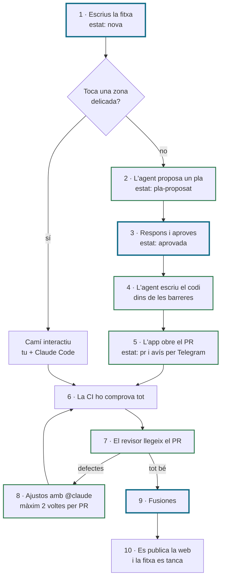

# El flux de treball del nucli

**Com Novak Code fa les webapps, de la fitxa a la web publicada.**

Tu escrius la fitxa, aproves el pla i fusiones. La resta la fan els agents a GitHub, dins d'unes barreres que es comproven soles, amb l'ordinador apagat o encès.

---

## Com és el procés

Cada canvi neix d'una fitxa i d'un pla que tu aproves. Els agents de Claude l'escriuen a GitHub, el proven i obren el PR, sense necessitat de tenir l'ordinador encès. Vuit barreres limiten el que poden tocar, i uns canaris comproven de debò que funcionen. Només tu pots fusionar, i res arriba a la web sense passar les proves. Tot queda escrit: la fitxa, el pla, el PR i el rebut.

## Què t'aporta

Deixes de ser l'embut: només intervens en tres moments, i ho pots fer des del mòbil. La feina avança encara que no siguis davant de l'ordinador. Hi ha menys errors i més seguretat, perquè les claus i la branca principal estan protegides. El consum de la subscripció queda controlat amb els límits del dia. I cada webapp nova pot començar amb el mateix procés, sense muntar-lo de zero.

---

## El camí d'una fitxa

Les caselles amb la vora blava són els tres moments en què intervens tu. Les verdes són els agents.

## Els deu passos

| # | Qui | Què passa |
|---|---|---|
| 1 | **Tu** | Escrius la fitxa amb el formulari, des del mòbil o l'ordinador. Neix amb `estat: nova`. Si toca una zona delicada, cap agent la fa: va pel camí interactiu. Les zones delicades són de cada projecte: el pas 5 de [Començar una webapp nova](../README.md#començar-una-webapp-nova) explica com es trien. |
| 2 | Agent del pla | Llegeix la fitxa i el repo, sense poder escriure res. Deixa el pla en un comentari, amb les preguntes que té, i posa `estat: pla-proposat`. |
| 3 | **Tu** | Contestes les preguntes en un comentari i poses `estat: aprovada`. L'agent no comença si queda alguna pregunta important sense resposta. |
| 4 | Agent que implementa | Escriu el codi dins de les barreres, el prova amb el nucli i en segella el rebut. Si una barrera salta, s'atura i ho diu a la fitxa. |
| 5 | App de l'agent | Puja una branca `issue/N-…`, mai forçada, i obre el PR amb `Closes #N`. La fitxa passa a `estat: pr` i t'arriba un avís per Telegram. |
| 6 | CI | El check obligatori: proves, lint, tipus, build i compliance. |
| 7 | Agent revisor | Quan poses l'etiqueta `revisa`, escriu un informe amb el que està bé i els defectes que s'han d'arreglar. |
| 8 | Agent que respon | Escrius `@claude` al PR i l'agent hi afegeix un commit; a una fitxa, et respon amb text. Només fa cas de les teves mencions. Màxim 2 voltes per PR. |
| 9 | **Tu** | Fusiones. Només tu pots: `main` està protegida i l'app de l'agent no hi pot escriure. |
| 10 | GitHub | La web es publica i la fitxa es tanca sola pel `Closes`. Cada dia feiner t'arriba un resum per Telegram. |

## El camí interactiu

Per a les fitxes amb zona delicada i per a les peces del mateix flux. Les fas tu amb Claude Code, i el nucli s'encarrega de la branca, de les comprovacions i del PR.

1. **Terminal:** `nucli tasca N` crea la branca de la fitxa i la posa `estat: en-curs`.
2. **Claude Code:** «Segueix amb la fitxa N».
3. **Terminal:** `nucli finish` passa les comprovacions, et demana les manuals, segella el rebut i obre el PR.
4. **GitHub:** la CI en verd, i fusiones.

## Les barreres de l'agent

1. **Només pot editar els fitxers de la llista** (`escrivibles` a `agents.json`).
2. **Mai els blindats:** workflows, configuració i els textos legals, com l'avís de risc.
3. **Mode `dontAsk`:** el que no està permès, està prohibit.
4. **Sense terminal, sense MCP i sense hooks.**
5. **La guarda** revisa el diff abans de pujar-lo.
6. **Cap clau** surt del job del model, i cap workflow fa servir la memòria cau.
7. **L'app de l'agent** no té permís de workflows ni pot escriure a `main`.
8. **Els canaris** ho proven de debò, a GitHub: intenten fer el que està prohibit i comproven que no ho aconsegueixen.

## Els límits del dia

| Què | Variable | Valor |
|---|---|---|
| Plans i respostes a fitxes | `AGENTS_PLANS_DIA` | 4 |
| Implementacions i ajustos | `AGENTS_IMPLEMENTACIONS_DIA` | 2 |
| Revisions | `AGENTS_REVISIONS_DIA` | 4 |
| Voltes d'ajust per PR | `voltes_pr` a `agents.json` | 2 |

Cada límit a 0 apaga aquell agent. Tots els repos comparteixen la mateixa subscripció.

## On intervens tu

| Moment | Què fas |
|---|---|
| **Escriure la fitxa** | El què i el criteri de fet. Des del mòbil. |
| **Aprovar el pla** | Respondre les preguntes i posar l'etiqueta. |
| **Fusionar** | Després de la CI i del revisor. |

## Com escriure una bona fitxa

- **Una sola cosa per fitxa.** Si en té dues, en fas dues.
- **Un criteri de fet que es pugui comprovar.** No «que quedi bonic», sinó «la pàgina 404 té el logotip i un botó per tornar a l'inici».
- **Petita:** mida S o M, i com a màxim 8 criteris.
- **Marca la zona amb sinceritat.** Si toca una zona delicada del projecte, com els pagaments o les dades, marca-la, encara que sembli petit.

## Estat d'implantació (octubre de 2026)

Al repo pilot de la web:

| Pas | Estat |
|---|---|
| 1 a 6 · Fitxa, pla, aprovació, implementació, PR i CI | ✅ 100 % |
| 7 · El revisor | ⏳ 0 % |
| 8 · Ajustos amb `@claude` | 🧪 90 %, en prova |
| 9 i 10 · Fusió i publicació | ✅ 100 % |

**Properes peces:** el bucle de correcció automàtic (el que troba el revisor torna sol a l'agent, fins a 2 voltes, i a la tercera t'avisa) i la plantilla de projecte nou, perquè una webapp nova arrenqui amb tot el flux en una hora.
